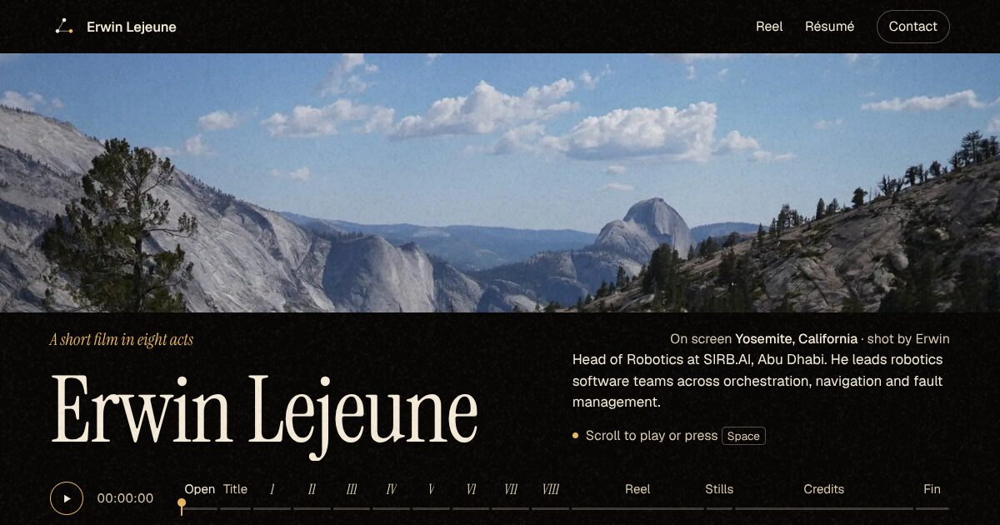

# elejeune.me — v5 · The Maze

A portfolio you solve.



Erwin won both maze-solving competitions in Coimbra and wrote a survey of
multi-agent pathfinding, so his site is a maze. It is a tabletop toy: kraft
walls, a paper floor, and a toy **M4**, the Caltech robot that rolls and flies
(he worked on its outdoor planning at TII). Point at the floor and a
multi-modal planner shows how it would get there: rolling, flying over the
walls, or morphing between the two. Click, and a ghost rehearses the route
before the robot sets off. Every room is a chapter of his career, and walking
(or flying) into one opens its story.

## How you move through it

- **Point at the floor** (mouse): all three planners run to that cell, the
  table compares them, and the chosen route is drawn faintly.
- **Click or tap the floor**: the search washes over the cells (blue for
  rolling states, orange for flying ones), the route is drawn (blue dots on
  the floor, orange dots in the air, a ring at each morph), a ghost rehearses
  it, then the robot goes.
- **F**, or the Fly button: fold the wheels into rotors and take off; again to
  land (over a wall, it hops to the nearest floor first). Left alone in the
  air, it lands by itself after a while.
- **V**, or the View button: **Top** (the board), **Chase** (behind the
  robot) or **First person** (its own camera, between the walls, or over
  them when it flies). In Chase and First person, **W/S** drive and **A/D**
  turn, relative to the robot; clicking the floor still plans a route.
- **Sensors** panel: **L** LiDAR, **C** costmap, **B** object detection,
  **Z** the robot camera's window (off, colour, depth).
- **Point at an object**: a card says what it is, whether it's *active* (you
  ask the robot to do something with it) or *passive* (it reacts to the robot
  by itself), and what you can do. Click the object to do the main thing; on
  a phone, tap it to pin the card. The same actions are in each room's "Try
  it" box in the story panel.
- **Planner** card: pick Hybrid, Roll only or Fly only, and slide between
  saving energy and saving time.
- **Scroll** (or swipe up, or press Page Down): the next room, in order. One
  gesture is one room, and the robot starts moving on the first wheel tick.
  Scroll past the end of a story to keep going.
- **Solve**: an autopilot tour of every room, with a pause in each.
- **Arrow keys / WASD**: drive cell by cell on the ground, or fly freely.
- **Map**: click a room (or any corridor) to go there.
- **List view**: the whole site as a plain, readable document. Without WebGL
  this is what you get.
- Links like `/#room-coimbra` start the robot in that room.

## The rooms

| | Room | What's in it |
| -- | -- | -- |
| 00 | Entrance | His name painted on the floor, the brand mark, a charging dock |
| 01 | Nantes | A resistor, a capacitor and a breadboard |
| 02 | Hiventive | The room is the chip: graphite package, gold pins, an STM32 die with TIM, I2C, CAN, GPIO, USART |
| 03 | Coimbra | A small maze on a table that a small robot keeps solving, and two trophies: mapped, unmapped |
| 04 | Centrale Nantes | The two papers on easels, an inverted pendulum balancing, and a blocks-world table: a PDDL planner, and M4's arm carries out the plan |
| 05 | Coalescent | Supermarket aisles and a trolley that gets a detection box when you walk in; M4 can dock to it and push it to the checkout |
| 06 | TII | Six robots plan around you with prioritized space-time A* (a PyMAPF nod); −74% CPU and −52% bandwidth painted on the floor |
| 07 | Unchained Labs | An intent → agents → jobs graph with pulses running along it |
| 08 | SIRB.AI | A flock of drones that forms up around M4 and follows it, rolling or flying; now and then one fails, drops, and recovers |
| 09 | Projects | The eight project clips on screens; the one you stand at plays |
| 10 | Off the clock | His photos, printed and scattered on the floor (click one) |
| 11 | Exit | A finish line, a mailbox, and how to reach him |

## M4 and its planner

- **The robot** (`src/maze/m4.ts`): a low body on four legs, each ending in a
  shrouded wheel with a propeller inside. To fly, each leg swings up and out
  about the body's long axis until the wheel lies flat and becomes a rotor;
  the body settles on its belly, the rotors spin up, and it climbs. Built from
  primitives, mirrored legs, one material.
- **The planner** (`src/maze/modal.ts`) is A* over (cell, mode) states.
  Rolling moves need floor; flying moves pass over walls and props but not
  the board's frame; a morph switches mode in place, only where the robot can
  stand. Each edge costs energy plus a weight times time, so the slider trades
  a cheap, slow roll against an expensive, quick flight. Rolling also pays a
  little for the costmap's inflation, so it keeps off the walls.
- **The heuristic** stays admissible: octile distance × the cheaper mode's
  per-cell cost, plus one morph if the robot is in the air (every plan ends
  landed). Roll-only and fly-only are the same search with moves switched off.
  A plan takes well under a millisecond.
- **The motion** (`src/maze/motion.ts`): rolling legs use the pure-pursuit
  drive, flying legs a holonomic follower that banks into its acceleration,
  and morphs are scripted (fold, spin up, climb; or descend, settle, unfold).
  The ghost replays the same steps as a fast timeline.
- **The costmaps** (`src/maze/costmap.ts`) follow nav2: lethal, inscribed, then
  exponential inflation. Two layers, because M4 has two bodies: rolling, every
  wall and prop is an obstacle; flying, only the frame is. The floor shader
  draws a rolling window of it around the robot and cross-fades the layers as
  it morphs.

## Things to do with objects

| Object | Room | Kind | What happens |
| -- | -- | -- | -- |
| Blocks world | Centrale | active | **Solve with PDDL**: plan, drive to the table, pick and place. **New goal**: random towers |
| Trolley | Coalescent | active | **Dock under** (LiDAR + ICP, or camera), then **carry** and **put down**; or **hook the handle** and **drag** |
| MAPF swarm | TII | passive | The six robots replan around M4 and ring it |
| Flock | SIRB.AI | passive | Thirty drones escort M4 on a mesh radio; **jam** it, **fail a drone**, **short range**, **bring them back** |
| Pendulum | Centrale | passive | Balances by itself |

- **M4's kit** (`src/maze/m4.ts`): an RGB-D camera on the nose (the first-person
  view and the camera window are its lens), a LiDAR low in the front bumper at
  the height of a trolley's legs, a lift deck in the middle of the back, and
  the arm on the left flank.
- **The arm** (`src/maze/arm.ts`): a turret, a shoulder, an elbow and a wrist
  that keeps the gripper pointing down, so reaching a point is a 3-DOF problem
  with a closed-form, elbow-up solution. It folds flat along its side, and
  stays folded in the air. For the blocks, M4 stands so the arm is centred on
  the table.
- **The PDDL planner** (`src/maze/pddl.ts`) parses the domain and the problem
  from the same text the panel shows, grounds every action over the objects,
  and runs A* with h_max (admissible, so plans are optimal). Four blocks
  ground to 40 actions and 29 facts; a plan takes a few milliseconds.
- **Plans become motion** (`src/maze/tasks.ts`): each action compiles to arm
  moves (above, down, grip, up) solved by IK against a simulation of the
  table, so every move targets where the blocks will be. Callbacks in the
  step queue hand a block to the gripper and back, and tick the plan in the
  panel.
- **Docking under the trolley** (`src/maze/dock.ts`). The trolley stands on
  four legs wrapped in retro-reflective tape, with a frame high enough for M4
  to drive under, and starts a little askew (5°, a few cm), so it has to be
  found, not assumed:
  - **LiDAR + ICP**: one 270° sweep from the bumper; the legs come back bright.
    Point-to-point ICP aligns a model of the four legs to the bright returns,
    from where the map says the trolley is. The LiDAR only sees the near side of
    a leg, so returns only pair with model points facing the sensor (otherwise
    a thin leg's arc fits as well on the back of the model, a few cm off). It
    converges in about eight iterations to a few mm; the robot drives in on the
    estimated axis and lifts.
  - **Camera**: the legs' feet are found in the image (with a pixel or so of
    noise), each pixel's ray is cast down to the floor, and the leg template is
    fitted to those floor points: a ground-plane PnP. The error grows with the
    square of the range, so it looks from 2.6 m, drives in along that estimate,
    and looks again from 2 m. A centimetre or two.
  - **Hook**: the camera estimate again, then the arm reaches the handle bar and
    the trolley is dragged on its casters.
  - Each dock reports its error against where the trolley really is. Parked,
    the trolley's cell is an obstacle; carried, it isn't; both costmap layers
    and the baked floor shadow are rebuilt when it moves.
- **The swarm's radio** (`src/maze/swarm.ts`): drones link to the drones in
  radio range; jamming and failures cut links. Union-find gives the groups;
  power iteration on the graph Laplacian gives λ₂, the algebraic connectivity.
  A drone cut off from the main group flies back toward the nearest drone still
  in it, slots are by rank among the drones still flying (so the formation
  closes up after a failure), and the formation shrinks with the radio range.
- **Anything else you ask for lets go first**: a held block goes back on the
  table, a docked trolley is pushed to the nearest spot and released, and the
  arm folds. Solve again and the planner starts from wherever the blocks are.

## What the robot sees

- **The camera** sits on M4's nose and tilts down a little more when it
  flies. First person is that camera, banking and bobbing with the body; the
  chase view trails the heading with a lag. Switching views blends position,
  orientation, field of view and fog over half a second.
- **Object detection** (`src/maze/sensors.ts`): every room reports its
  detectable things with live boxes (blocks, the trolley, the pendulum, the
  posters, the swarm robots, the drones, the project screens). At 10 Hz the
  detector keeps those inside the camera's frustum and range, probes three
  lines of sight past the walls, and scores a confidence from distance and
  occlusion. Tracks keep their ID through short gaps. Boxes are drawn on a 2D
  canvas over the scene, in whichever view you're in; from above you also see
  the camera's field of view, cut off by the walls.
- **The camera window** renders the scene a second time from the lens into a
  small frame: in colour, or as depth (linear distance through a Turbo colour
  map, with an override material that also handles the instanced meshes).
- **Driving by hand** in the first-person views sets speed and turn rate
  directly, and slides along walls and props instead of entering them.

## How it's built

- **Page first.** `index.html` holds every word. The story panel, the list view
  and the no-WebGL fallback are the same HTML; CSS decides how it's laid out.
  The page's own JS is 7 KB gzipped and draws the minimap without three.js.
- **3D second.** three.js loads with a dynamic `import()` once the fonts are in.
- **The maze** (`src/maze/layout.ts`) is a seeded recursive backtracker over the
  corridor lattice, with rooms carved first, doors opened per side, and some
  dead ends braided into loops. Same seed, same maze, every visit.
- **Walls** are merged into straight runs: 163 boxes in one `InstancedMesh`.
  Soft clay edges and the dark foot of each wall come from the shader.
- **Light** is baked: ambient occlusion and the sun's shadow are computed once
  into a 228×172 texture. No shadow maps, no post-processing.
- **The search** is a float texture with one texel per cell holding the time
  the search closed it and in which mode; the floor shader turns that into the
  fading wash. One upload per plan, nothing per frame.
- **Everything painted on the floor** (room names, the chip die, the
  breadboard, the stats) shares one canvas atlas and one draw call.
- **It sleeps.** After 16 s without input the robot dozes off, the LiDAR
  winds down and rendering stops. The tab being hidden also stops it.
- `prefers-reduced-motion`: the robot jumps to its goal, morphs are instant,
  there's no ghost, the camera cuts, and nothing animates on its own.

Run with `?perf` to see the per-frame cost.

## Structure

```
index.html              all the content (12 rooms)
src/main.ts             story panel, map, scroll/keys/swipe, list view, photo viewer, lazy-loads the world
src/styles.css          the design system: table, paper, kraft, one red, one blue
src/media.ts            the project clips and photos used by the 3D rooms
src/maze/layout.ts      the seeded grid and the rooms (no three.js)
src/maze/astar.ts       grid helpers: nearest floor cell, clearance checks, line-of-sight smoothing
src/maze/modal.ts       multi-modal A*: roll, fly, morph; the cost model
src/maze/costmap.ts     rolling and flying costmaps (nav2-style inflation)
src/maze/motion.ts      plan execution (drive, fly, morph, line, turn, arm, grip, callbacks), the ghost's rehearsal
src/maze/m4.ts          the M4 model
src/maze/arm.ts         the arm on M4's back and its closed-form IK
src/maze/pddl.ts        a small PDDL parser, grounder and A* (h_max) planner; the blocks domain
src/maze/blocks.ts      the blocks-world table
src/maze/tasks.ts       active interactions: PDDL plans and docking compiled into motion steps
src/maze/sensors.ts     object detector with tracks, the camera's view fan, the first-person HUD, depth shader
src/maze/dock.ts        trolley perception: LiDAR scan, ICP, ground-plane camera pose, and how they're drawn
src/maze/swarm.ts       the swarm's radio network: links, groups, λ₂
src/maze/drive.ts       differential-drive kinematics + pure pursuit
src/maze/mapf.ts        prioritized space-time A* for the swarm room
src/maze/world.ts       renderer, views, sensors, input, hover cards, planning, preview, tour, sleep
src/maze/floor.ts       floor shader, baked light, search texture, costmap window
src/maze/walls.ts       the walls
src/maze/robot.ts       the small robots in the swarm room
src/maze/fx.ts          dotted route (rolling and flying), tyre tracks, LiDAR returns
src/maze/props.ts       the rooms' props and floor paint
public/work/            project clips (960px, 30 s loops) and posters
public/photos/          twelve photos at 800 and 1600px
```

## Commands

| Command           | Action                             |
| :---------------- | :--------------------------------- |
| `npm install`     | Install dependencies               |
| `npm run dev`     | Dev server at `localhost:5173`     |
| `npm run build`   | Typecheck, then build to `./dist/` |
| `npm run preview` | Preview the build                  |
